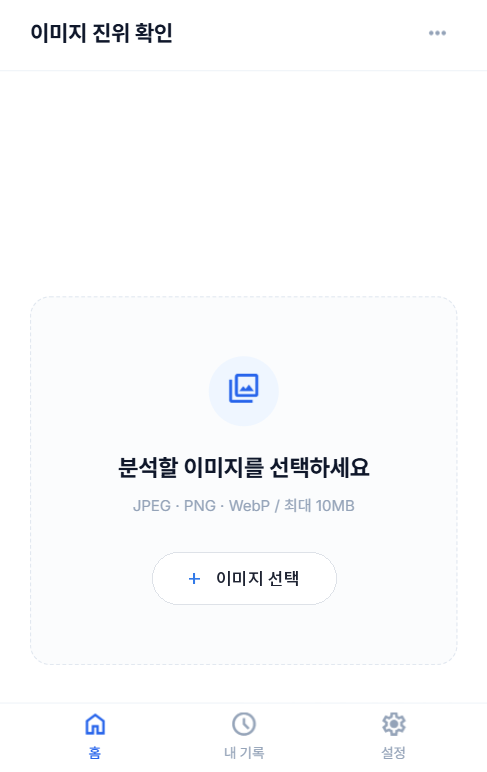
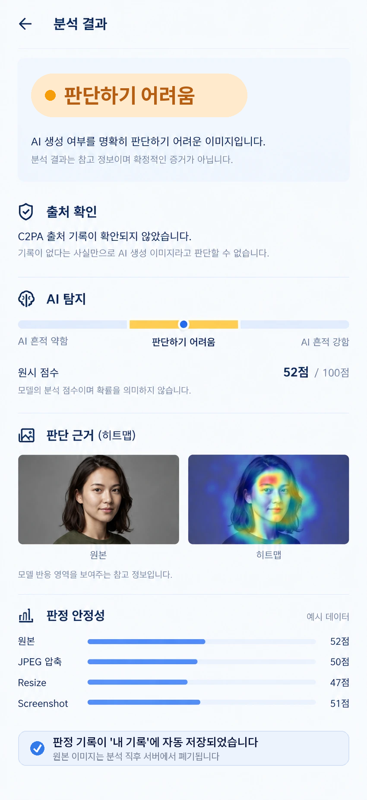
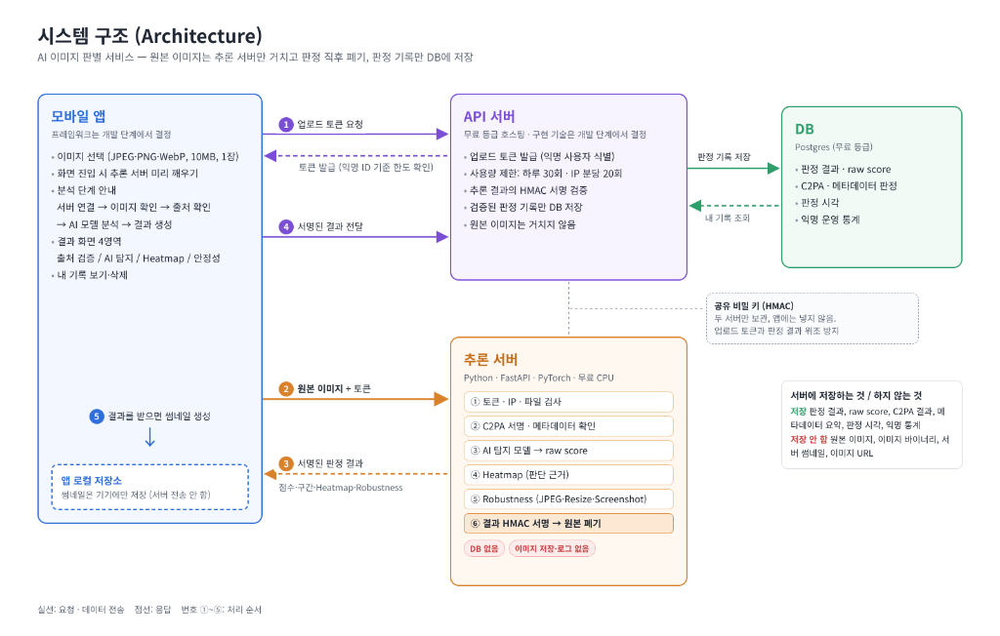

# AI 이미지 판별 서비스

**인공지능서비스개발II 팀 프로젝트 기획서**

2026. 10. 14.

| 팀명 | 18조 |  |
|---|---|---|
| 팀장 | 202204195 | 김정효 |
| 팀원 | 202304124 | 임정민 |

## 요약

> **프로젝트 개요**
>
> 본 프로젝트는 사용자가 이미지 한 장을 선택하면 출처 기록 검증, AI 생성 가능성 추정, 판단 근거, 판정 안정성을 구분하여 제공하는 참고용 모바일 애플리케이션 ‘AI 이미지 판별 서비스'를 개발하고 배포하는 것을 목표로 한다. 본 서비스는 AI 생성 여부를 단정하지 않으며, 사용자가 이미지의 진위를 신중하게 판단하도록 돕는 참고 정보를 제공한다.
>
> **개발 배경 및 필요성**
>
> 생성형 AI로 만든 이미지가 상품 사기, 영수증 위조, 딥페이크 범죄 등에 악용되고 있으나, 일반 사용자가 이미지의 외형만으로 진위를 구분하기는 어렵다. 또한 메타데이터는 쉽게 삭제하거나 변경할 수 있고, AI 탐지 모델은 실제 사진을 AI 이미지로 잘못 판단할 수 있다. 따라서 단일 판정 결과보다 출처 정보, 판단 근거, 결과의 불확실성을 함께 제공하는 서비스가 필요하다.
>
> **주요 기능**
>
> - 출처 확인: C2PA 출처 기록의 서명과 무결성을 검증하고, EXIF 등 메타데이터는 참고 정보로 구분한다.
> - AI 생성 가능성 추정: 공개 사전학습 모델 3종(UnivFD, AIDE, NPR)의 점수를 앙상블하여 ‘AI 흔적 강함 / 판단하기 어려움 / AI 흔적 약함'의 세 구간으로 표시하고, 모델 간 판단이 엇갈리면 ‘판단하기 어려움'으로 표시한다.
> - 판단 근거 시각화: 모델이 반응한 영역을 히트맵으로 원본 위에 겹쳐 보여준다.
> - 판정 안정성 분석: JPEG 압축, Resize, Screenshot 변형 전후의 점수 변화를 비교한다.
> - 내 기록 및 개인정보 보호: 원본 이미지는 분석 직후 폐기하고, 최소한의 판정 기록만 저장한다.
>
> **시스템 구성 및 개발 방법**
>
> 시스템은 모바일 앱, API 서버, 추론 서버(Python FastAPI, PyTorch), DB(PostgreSQL)로 구성한다. 원본 이미지는 앱에서 추론 서버로 직접 전송하고, 두 서버가 공유하는 비밀 키로 토큰과 결과에 HMAC 서명을 붙여 위조를 방지한다. 탐지 모델은 처음부터 학습하지 않고, 서로 다른 단서를 보는 공개 사전학습 모델 3종(UnivFD, AIDE, NPR)을 앙상블한다. 각 모델의 점수를 보정한 뒤 로지스틱 회귀로 융합(스태킹)하고, 모델 간 의견 불일치를 불확실성 지표로 활용한다. 또한 공개 가중치가 과거 생성기(ProGAN) 데이터로 학습된 UnivFD는 백본을 고정한 채 최신 생성 이미지와 변형 이미지로 분류층을 재학습하는 전이학습을 적용한다. 평가에는 실제 사진과 AI 이미지 약 200장을 4가지 버전으로 만든 약 800장의 검증 데이터를 사용한다. 실제 사진 오탐률(FPR) 5% 이하를 핵심 기준으로 융합 가중치와 세 구간의 경계값을 결정한다.
>
> **개발 일정 및 역할**
>
> - Sprint 1(~8주): 모델 3종 평가, 앙상블 설계와 기본 추론
> - Sprint 2(9~12주): 전이학습 적용, 결과 화면의 네 영역 구현
> - Sprint 3(13~15주): 기록, 보안, 배포, 통합 테스트
>
> **기대 효과**
>
> 본 서비스는 전문 지식이나 비용 없이 이미지의 진위를 확인할 수 있는 참고 정보를 제공하여 상품 사기와 허위 정보 확산 피해를 줄이는 데 도움을 준다. 또한 단정하지 않는 결과 표시로 실제 사진이 AI 이미지로 오해받는 일을 줄이고, 사용자가 근거를 구분해 스스로 판단하는 미디어 리터러시 향상에 기여할 것으로 기대한다.

## 1. 개발 배경 및 필요성

### 1.1 개발 배경

생성형 인공지능 기술이 발전하면서 실제 촬영한 사진과 구분하기 어려울 정도로 정교한 이미지가 제작되고 있다. 이러한 기술은 콘텐츠 제작과 디자인 등 다양한 분야에서 활용되지만, 허위 정보 유포와 상품 사기, 서류 위조, 딥페이크 범죄 등에 악용될 가능성도 커지고 있다. 이에 따라 일반 사용자도 이미지의 진위 여부를 확인할 수 있도록 돕는 기술적 지원이 필요하다.

실제로 AI 생성 이미지를 악용한 사례는 다음과 같다.

| 악용 유형 | 주요 사례 및 문제점 |
|---|---|
| 서류 위조 | 생성형 AI로 실제와 유사한 영수증을 제작해 경비를 청구하는 사례가 나타나고 있다. 한 경비 관리 업체 자료에 따르면 2025년 9월 위조 영수증 중 AI 생성 영수증의 비중은 약 14%로, 1년 전에는 0%였던 것으로 보고되었다. |
| 온라인 상품 사기 | AI로 생성한 존재하지 않는 식물의 이미지를 이용해 씨앗을 판매한 사례가 보도되었다. 한 가짜 장미 씨앗 판매 게시물은 판매자가 퇴출되기 전까지 37,271건의 판매가 이루어진 것으로 알려졌다. |
| 딥페이크 범죄 | AI로 생성하거나 조작한 이미지가 성범죄, 사기, 정치적 조작 등에 악용될 수 있으며, 생성 기술의 발전 속도를 탐지 기술이 따라가지 못할 가능성도 문제로 지적된다. |

이러한 사례는 이미지가 정보를 전달하는 수단을 넘어 소비자의 판단과 사회적 신뢰에 영향을 미칠 수 있음을 보여준다. 특히 메타데이터는 삭제하거나 변경할 수 있고, 이미지의 외형만으로는 생성 여부를 구분하기 어려울 수 있다. 따라서 단순한 AI 판별 결과뿐 아니라 출처 정보와 판단 근거, 결과의 불확실성을 함께 제공하는 서비스가 필요하다.

### 1.2 개발 필요성 및 해결하려는 문제

본 프로젝트는 이미지의 출처 정보와 AI 탐지 모델의 분석 결과를 함께 제공하는 모바일 서비스를 개발하여, 일반 사용자가 이미지의 진위를 보다 신중하게 판단하도록 돕고자 한다. 해결하려는 주요 문제와 대응 방향은 다음과 같다.

① 일반 사용자의 이미지 판별 어려움

AI 생성 이미지의 품질이 높아지면서 전문 지식 없이 이미지의 진위를 구분하기 어려워지고 있다. 이에 사용자가 이미지 한 장을 선택하는 것만으로 출처 정보와 AI 생성 가능성에 대한 참고 정보를 확인할 수 있도록 한다.

② 탐지 결과의 오판 가능성

AI 탐지 모델은 실제 사진을 AI 생성 이미지로 잘못 판단하거나, 반대로 AI 생성 이미지를 실제 사진으로 판단할 수 있다. 이를 고려해 결과를 ‘AI 흔적 강함’, ‘판단하기 어려움’, ‘AI 흔적 약함’으로 구분하고, 실제 사진 오탐률(FPR)을 핵심 평가 지표로 관리한다. 또한 서로 다른 단서를 보는 여러 모델을 앙상블하여 단일 모델의 오판을 보완하고, 모델 간 판단이 엇갈리는 경우에는 ‘판단하기 어려움’으로 표시한다. 오탐률 5% 이하는 개발 목표로 설정하고 실험을 통해 달성 여부를 평가한다.

③ 판단 근거별 신뢰 수준의 차이

서명된 C2PA 출처 기록은 서명과 무결성을 검증할 수 있는 정보이며, 일반 메타데이터는 변경될 수 있고 AI 탐지 모델의 점수는 추정치이다. 따라서 세 가지 정보를 하나의 결론으로 합치지 않고 각각 구분하여 제시함으로써 사용자가 근거의 성격과 한계를 이해하도록 한다.

④ 출처 기록이 없는 이미지의 판별 한계

C2PA 기록은 처음부터 존재하지 않거나 이미지의 저장·공유 과정에서 사라질 수 있다. 그러므로 출처 기록이 없다는 이유만으로 AI 생성 이미지라고 판단해서는 안 된다. 본 서비스는 출처 기록 검증과 이미지 자체를 분석하는 AI 탐지 모델을 함께 활용한다.

⑤ 이미지 제공에 따른 개인정보 보호 문제

사용자가 개인 이미지를 외부 서비스에 업로드할 때 발생할 수 있는 저장 및 오용 우려를 줄일 필요가 있다. 이에 원본 이미지는 분석에 필요한 동안에만 처리하고 분석 완료 후 서버에서 폐기한다. 결과 이력 관리에는 필요한 최소한의 정보만 활용하며, 이미지 미리보기는 앱 내부 저장소에서 관리하도록 설계한다.

### 1.3 기존 서비스와의 차별성

기존 AI 이미지 탐지 서비스는 모델의 점수나 생성 가능성 추정에, 출처 확인 서비스는 콘텐츠에 포함된 출처 기록의 검증에 초점을 맞춘다. 그러나 어느 한 가지 정보만으로 이미지의 진위를 확정하기는 어렵다. 이에 본 프로젝트는 여러 분석 정보를 한 화면에서 제공하되, 각 정보의 의미와 한계를 구분하는 것을 차별화 방향으로 설정한다.

| 구분 | 주요 역할 | 한계 및 본 서비스의 보완 방향 |
|---|---|---|
| AI 이미지 탐지 | 이미지 자체를 분석하여 AI 생성 가능성을 추정 | 모델의 오판 가능성을 고려해 불확실성 및 오탐률을 함께 관리 |
| 출처 기록 확인 | C2PA 기록과 전자서명의 검증 상태 확인 | 기록이 없다고 AI 생성 이미지인 것은 아니므로 AI 탐지와 병행 |
| 본 프로젝트 | 출처 검증, AI 탐지, 판단 근거 시각화, 판정 안정성 분석 제공 | 서로 다른 근거를 구분하여 종합적인 판단에 필요한 참고 정보 제공 |

본 서비스의 주요 차별점은 다음과 같다.

① 출처 검증과 AI 탐지의 결합

C2PA 기반 출처 기록의 서명 및 무결성 검증 결과와 AI 탐지 모델의 분석 결과를 함께 제공한다. 이를 통해 검증 가능한 출처 정보와 모델이 이미지 자체를 분석하여 추정한 정보를 구분할 수 있도록 한다.

② 판단 근거의 시각화

AI 탐지 모델이 이미지의 어떤 영역에 반응했는지 히트맵으로 시각화한다. 단순한 점수뿐 아니라 모델의 반응 영역을 함께 보여주어 결과를 이해하는 데 도움을 주되, 해당 영역이 AI 생성의 직접적인 증거는 아니라는 점을 안내한다.

③ 판정 안정성 분석

동일한 이미지에 JPEG 압축이나 크기 변경 등의 변형을 적용하고, 변형 전후의 탐지 점수를 비교한다. 점수가 크게 달라지는 경우 결과 해석에 주의가 필요하다는 정보를 제공한다. 이러한 변형 전후의 안정성 분석을 출처 검증 및 AI 탐지와 함께 제공하는 방식은 본 프로젝트의 차별화 가능성으로 설정하며, 관련 서비스와 연구에 대한 추가 조사를 통해 차별성을 검증한다.

종합하면, 본 프로젝트는 AI 생성 여부를 단정적으로 판정하는 것이 아니라 출처 검증, AI 모델 추정, 판단 근거 시각화, 판정 안정성 분석을 통해 사용자가 이미지의 진위를 보다 신중하게 판단하도록 돕는 모바일 서비스를 목표로 한다.

## 2. 개발 목표

### 2.1 개발 목표

본 프로젝트의 목표는 사용자가 이미지 한 장을 업로드하면 AI 생성 가능성과 그 판단 근거를 확인할 수 있는 모바일 애플리케이션을 개발하고 배포하는 것이다. 본 서비스는 AI 생성 여부를 확정적으로 판별하는 것을 목표로 하지 않으며, C2PA 기반 출처 기록 검증, AI 탐지 모델의 추정 결과, 판단 근거 시각화, 판정 안정성 분석을 종합적으로 제공하여 사용자가 이미지의 진위를 신중하게 판단하도록 돕는 것을 핵심 목표로 한다.

이를 위해 공개 사전학습 모델과 기존 출처 검증 기술을 활용하고, 각 분석 결과의 성격과 신뢰 수준을 구분하여 제공한다. 또한 실제 사진을 AI 생성 이미지로 잘못 판단하는 오탐을 줄이고, 원본 이미지의 서버 저장을 방지하는 구조를 설계하여 서비스의 신뢰성과 개인정보 보호를 함께 고려한다.

### 2.2 세부 개발 목표

첫째, 이미지 한 장으로 이용할 수 있는 간편한 분석 환경을 구축한다.

사용자는 별도의 회원가입 없이 JPEG, PNG, WebP 형식의 이미지 한 장을 선택하여 분석할 수 있도록 한다. 업로드 가능한 이미지의 최대 크기는 10MB로 제한한다. 또한 이미지 선택 화면에 진입하면 추론 서버를 미리 활성화하여 서버 응답 지연을 줄이고, 분석 과정에서는 서버 연결, 이미지 확인, 출처 정보 확인, AI 모델 분석, 결과 생성의 진행 단계를 화면에 표시한다. 이를 통해 사용자가 분석 진행 상황을 이해하고 결과를 기다릴 수 있도록 한다.

둘째, 이미지의 출처 기록과 AI 생성 가능성을 구분하여 제공한다.

C2PA 기반 출처 기록이 포함된 경우, 전자서명과 무결성 검증 결과를 확인하고 기록에 포함된 생성 및 편집 이력을 제공한다. 검증된 기록에서 AI 생성 관련 정보가 확인되면 ‘AI 생성 기록 있음(서명 확인)’, 카메라 촬영 관련 정보가 확인되면 ‘카메라 촬영 기록 있음(서명 확인)’과 같이 표시한다. 단, 서명이 유효하다는 사실과 기록에 담긴 모든 내용이 절대적으로 사실이라는 주장은 구분한다. C2PA 기록이 없거나 서명 검증이 불가능한 경우에도 이를 곧바로 AI 생성 이미지로 판단하지 않는다. 일반 EXIF 메타데이터나 생성 도구 관련 흔적은 변경될 수 있으므로 참고 정보로 구분하며, 출처 기록의 검증 결과와 AI 탐지 모델의 분석 결과를 별도로 제시한다. 또한 유효한 출처 기록이 존재하더라도 AI 탐지 모델을 항상 실행하여 두 분석 결과를 함께 확인할 수 있도록 한다.

셋째, 공개 사전학습 모델 3종의 앙상블로 AI 생성 가능성을 추정한다.

이미지의 서로 다른 특성을 분석하는 공개 사전학습 모델 3종(UnivFD, AIDE, NPR)을 활용한다. UnivFD는 CLIP의 의미 특징을, AIDE는 의미 특징과 주파수 기반 저수준 특징을, NPR은 생성 과정의 업샘플링으로 생기는 이웃 픽셀 간 관계를 단서로 사용한다. 이 중 UnivFD는 공개 가중치가 과거 생성기(ProGAN) 이미지로 학습되어 최신 확산 모델 이미지에 약할 수 있으므로, CLIP 백본은 고정하고 최신 생성 이미지와 JPEG 압축·크기 변경 이미지로 분류층만 재학습하는 전이학습을 적용한다. 각 모델은 이미지에 대한 원점수(raw score)를 산출하며, 모델마다 점수의 범위와 분포가 다르므로 검증 데이터로 각 점수를 보정한 뒤 로지스틱 회귀 기반 스태킹으로 하나의 융합 점수를 계산한다. 융합 점수를 기반으로 ‘AI 흔적 강함’, ‘판단하기 어려움’, ‘AI 흔적 약함’의 세 구간으로 구분하여 표시하며, 융합 점수가 높거나 낮더라도 모델 간 판단이 크게 엇갈리면 ‘판단하기 어려움’으로 표시한다. 앙상블이 단일 모델보다 실제 사진 오탐률을 낮추는지는 비교 실험으로 검증하며, 개선 효과가 없으면 가장 우수한 단일 모델을 사용한다. 모델의 원점수가 보정되지 않은 상태라면 이를 실제 AI 생성 확률로 표현하지 않는다. 또한 판정 기준을 충족하지 못하거나 모델의 판단이 불확실한 경우에는 ‘판단하기 어려움’을 표시하여 사용자가 결과를 확정적인 결론으로 받아들이지 않도록 한다. 실제 사진을 AI 생성 이미지로 잘못 분류하는 오탐률(False Positive Rate, FPR)을 핵심 성능 지표로 관리하며, 실제 사진 오탐률 5% 이하를 개발 목표로 설정한다. 해당 목표의 달성 여부는 별도의 평가 데이터와 실험 결과를 통해 검증한다.

넷째, AI 탐지 결과의 판단 근거를 시각화한다.

AI 탐지 모델이 이미지의 어떤 영역에 반응했는지 확인할 수 있도록 히트맵(Heatmap)을 생성하고, 이를 원본 이미지 위에 겹쳐 표시한다. 이를 통해 사용자가 모델의 분석 결과를 시각적으로 이해할 수 있도록 한다. 다만 히트맵은 모델의 반응 영역을 나타내는 참고 자료이며, 해당 영역이 AI 생성의 직접적인 증거라는 의미는 아니라는 점을 함께 안내한다.

다섯째, 이미지 변형에 따른 판정 안정성을 비교한다.

동일한 이미지에 JPEG 압축, 크기 변경(Resize), 스크린샷 변환(Screenshot) 등의 변형을 적용하고, 각 이미지에 대한 AI 탐지 모델의 원점수를 비교한다. 결과 화면에서는 원본과 변형 이미지의 점수를 막대그래프 등으로 시각화하여 변형에 따라 판정 결과가 얼마나 달라지는지 확인할 수 있도록 한다. 이를 통해 단일 이미지에 대한 판정 결과뿐 아니라 이미지의 저장 및 공유 과정에서 발생할 수 있는 변형이 모델의 판단에 미치는 영향도 함께 제공한다. 변형 전후의 점수 차이는 모델의 안정성을 이해하기 위한 참고 지표로 활용하며, 점수가 비슷하다는 사실만으로 판정이 정확하다고 단정하지 않는다.

여섯째, 개인정보 보호를 고려한 분석 및 결과 저장 구조를 구축한다.

원본 이미지는 분석에 필요한 동안에만 서버에서 처리하고, 분석이 완료되면 서버에 남지 않도록 폐기한다. 이미지 미리보기는 앱 내부 저장소에서 관리하며, 서버에는 결과 이력 관리와 서비스 운영에 필요한 최소한의 정보만 저장한다. 저장 대상에는 모델 원점수, C2PA 검증 결과, 최소한의 메타데이터 요약, 분석 시각 등이 포함될 수 있으며, 원본 이미지 자체는 저장하지 않는다. 사용자는 별도의 회원가입 없이 분석 서비스를 이용하고, 이전 분석 결과는 앱의 ‘내 기록’에서 확인할 수 있도록 한다. 또한 이미지 처리 과정에서 GPS 위치 등 불필요한 민감 정보가 수집되거나 저장되지 않도록 설계한다.

### 2.3 주요 이용 대상

본 서비스의 주요 이용 대상은 다음과 같다.

- 일반 사용자: 뉴스, SNS, 온라인 커뮤니티 등에서 접한 이미지의 AI 생성 가능성이 궁금한 사용자

- 온라인 쇼핑 구매자: 상품 사진이 실제 상품이나 실제 촬영 환경을 반영하는지 참고 정보를 확인하고 싶은 사용자

- 학생 및 교육 현장: 발표 자료, 과제, 교육용 이미지 등의 출처와 신뢰성을 확인하고 싶은 사용자

본 서비스는 위 이용자들이 전문적인 이미지 분석 지식 없이도 이미지의 출처 정보와 AI 탐지 결과를 확인할 수 있도록 하는 데 목적이 있다. 다만 분석 결과만으로 이미지의 진위나 상품의 실재 여부를 확정할 수는 없으며, 필요한 경우 추가적인 출처 확인을 병행하도록 안내한다.

### 2.4 서비스 경쟁력 및 확장 목표

본 프로젝트는 단순히 AI 생성 이미지를 더 정확하게 판별하는 것만을 목표로 하지 않는다. 사용자가 분석 결과를 어느 정도 신뢰할 수 있는지 스스로 판단하도록 돕는 것을 핵심 경쟁력으로 설정한다.

첫째, 결과의 신뢰 수준을 구분한다. C2PA 서명 검증 결과, 일반 메타데이터, AI 탐지 모델의 추정 결과를 별도로 표시하고, 모델의 불확실성이 큰 경우에는 ‘판단하기 어려움’을 제공한다. 또한 실제 사진 오탐률을 핵심 평가 지표로 관리하여 모델 성능을 객관적으로 검토한다.

둘째, 개인정보 보호를 서비스 설계에 반영한다. 원본 이미지를 서버에 영구 저장하지 않고 회원가입 없이 이용할 수 있도록 하여 사용자의 이용 부담을 줄인다. 초기 서비스는 무료 이용을 목표로 하되, 실제 배포와 운영에 필요한 서버 및 추론 비용은 별도로 검토한다.

셋째, 분석 근거를 확장할 수 있는 구조를 설계한다. 출처 기록, 모델 추정, 시각화, 안정성 분석을 별도 기능으로 구성하여 추후 새로운 검증 기술이나 분석 모델을 추가하더라도 기존 결과의 의미가 혼합되지 않도록 한다. 또한 모델별 원점수, 앙상블 융합 점수, 표시 구간을 분리하여 관리하고 보정 계수·융합 가중치·경계값을 설정 파일로 관리함으로써 모델 추가·교체나 판정 경계값 조정에 유연하게 대응할 수 있도록 한다.

넷째, 출처 기록 활용 확대에 대응할 수 있는 기반을 마련한다. 향후 C2PA를 지원하는 생성 도구와 카메라, 편집 도구가 확대되면 검증 가능한 출처 기록을 활용할 기회도 늘어날 수 있다. 본 서비스는 이러한 변화에 대응할 수 있도록 출처 기록 검증 모듈을 독립적으로 구성한다. 다만 C2PA 기록이 없는 이미지도 존재하므로, 출처 검증만으로 모든 이미지의 진위를 판단하지 않고 AI 탐지 기능을 함께 유지한다.

### 2.5 최종 결과물

최종 결과물은 사용자가 이미지 한 장을 선택하여 분석을 요청하고, 출처 기록 검증 결과와 AI 생성 가능성 추정, 히트맵, 이미지 변형에 따른 판정 안정성을 확인할 수 있는 모바일 애플리케이션이다. 이를 지원하기 위해 API 서버, 추론 서버, 결과 저장 데이터베이스를 연계하고, 원본 이미지의 서버 저장을 방지하는 처리 구조를 구현한다.

모든 분석 결과에는 ‘본 결과는 참고용이며 AI 생성 여부를 보장하지 않습니다’라는 안내를 표시한다. 최종적으로는 기능 구현뿐 아니라 실제 사진과 AI 생성 이미지로 구성된 평가 데이터를 활용하여 탐지 성능과 오탐률을 측정하고, 이미지 변형에 따른 점수 변화 및 출처 기록 검증 결과를 테스트함으로써 서비스의 실현 가능성과 한계를 함께 평가하고자 한다.

## 3. 벤치마킹(또는 관련 연구)

### 3.1 유사 서비스 분석

AI 생성 이미지 탐지와 출처 확인을 지원하는 기존 서비스의 주요 기능을 조사하고, 본 프로젝트에 적용할 수 있는 요소와 차별화 방향을 분석하였다. 벤치마킹 대상은 AI 이미지 탐지 서비스, 콘텐츠 출처 검증 도구, 이미지 분석 도구로 구분하였다.

| 서비스 | 주요 기능 | 참고할 점 | 본 프로젝트의 차별화 방향 |
|---|---|---|---|
| Hive AI Detector | AI 생성 여부와 생성 모델 추정, 관련 C2PA 메타데이터 제공 | 모델 분석 결과와 출처 관련 정보를 함께 확인하는 방식 | 결과를 세 구간으로 구분하고, 판단 근거와 변형에 따른 판정 안정성을 추가 제공 |
| Sightengine | 픽셀 기반 AI 이미지 탐지 및 불확실한 결과 범주 제공 | 판단이 불확실한 경우를 별도로 표시하는 방식 | 출처 기록 검증과 판정 안정성 분석을 함께 제공 |
| AI or Not | 이미지 업로드를 통한 AI 생성 여부 및 생성기별 분석 결과 제공 | 간편한 이미지 업로드와 항목별 결과 구성 | 보정되지 않은 점수를 확률로 표현하지 않고, 불확실성을 고려한 세 구간으로 표시 |
| Content Credentials Verify | C2PA 콘텐츠 출처 기록과 검증 상태 확인 | 서명된 출처 기록을 확인하고 그 내용을 살펴보는 방식 | 출처 검증뿐 아니라 이미지 자체를 분석하는 AI 탐지 기능도 제공 |
| Google SynthID | AI 생성 콘텐츠에 삽입된 SynthID 워터마크 탐지 | 워터마크를 활용해 생성 콘텐츠의 출처를 확인하는 방식 | 특정 워터마크에만 의존하지 않고 C2PA 검증과 공개 사전학습 모델을 함께 활용 |
| Illuminarty | AI 생성 가능성 추정, 생성 모델 관련 분석, 의심 영역 시각화 | 결과 점수와 이미지 내 관련 영역을 함께 보여주는 방식 | 히트맵을 참고 정보로 안내하고, 이미지 변형 전후의 점수 변화도 제공 |
| FotoForensics | ELA 및 메타데이터 등 이미지 분석 도구 제공 | 서로 다른 분석 결과를 구분하여 살펴보는 방식 | AI 탐지와 출처 검증을 결합하고, 원본 이미지의 서버 저장을 최소화하는 구조를 지향 |

Hive는 AI 생성 여부와 생성 모델 추정 결과를 제공하며, 이미지에 C2PA 메타데이터가 존재하면 관련 정보도 응답에 포함할 수 있다. AI or Not은 픽셀 정보를 바탕으로 이미지를 분석하고, Sightengine은 AI 생성 여부가 불확실한 경우를 별도 범주로 제시한다.

출처 검증 분야에서는 Content Credentials Verify가 C2PA 기록을 확인하는 방식을 참고할 수 있으며, Google SynthID는 콘텐츠에 삽입된 디지털 워터마크를 탐지하는 별도의 접근법을 제공한다. Illuminarty는 이미지의 AI 생성 가능성과 관련 영역을 함께 보여주는 기능을 제공한다.

이러한 서비스는 이미지 탐지, 출처 확인, 결과 시각화 등 본 프로젝트에 적용할 수 있는 기능을 각각 제공한다. 본 프로젝트는 이들 기능을 단순히 나열하는 데 그치지 않고, 각 결과의 성격을 구분하면서 한 화면에서 확인할 수 있도록 통합하는 방향을 설정하였다.

### 3.2 관련 연구 및 탐지 모델 후보

본 프로젝트는 AI 탐지 모델을 처음부터 학습시키기보다 공개 사전학습 모델을 활용하여 개발 기간과 구현 부담을 줄이고자 한다. 단일 모델은 특정 생성기나 이미지 변형에 취약할 수 있으므로, 서로 다른 단서를 사용하는 모델 3종을 앙상블하여 상호 보완하는 방식을 채택한다. 앙상블의 효과는 정확도가 높은 모델을 여러 개 모으는 것보다 서로 다른 유형의 오류를 내는 모델을 결합할 때 커지므로, 의미 기반 모델과 픽셀 흔적 기반 모델을 함께 구성하였다.

| 대상 | 주요 내용 | 앙상블 내 역할 | 검토 항목 |
|---|---|---|---|
| UnivFD (Ojha et al., CVPR 2023) | 고정된 CLIP ViT-L/14 특징 위에 선형 분류기를 학습하여, 학습에 사용되지 않은 생성 모델에 대한 일반화를 목표로 한다. | 의미 특징 기반 판단, 전이학습 적용 대상 | CPU 추론 시간, 최신 확산 모델 이미지에 대한 성능(공개 가중치는 ProGAN 데이터로 학습), 분류층 재학습 효과 |
| AIDE (Yan et al., ICLR 2025) | 이미지 패치의 주파수(DCT) 특성으로 저수준 흔적을 추출하는 ResNet 전문가와 OpenCLIP ConvNeXt 의미 특징을 결합한다. | 의미 특징과 저수준 특징의 혼합 판단 | 약 9억 개 파라미터로 인한 메모리 사용량과 CPU 추론 시간 |
| NPR (Tan et al., CVPR 2024) | 생성 네트워크의 업샘플링 과정에서 생기는 이웃 픽셀 간 관계(Neighboring Pixel Relationships)를 단서로 사용하는 경량 CNN이다. | 픽셀 흔적 기반 판단, 경량 대표 모델 | JPEG 압축·크기 변경에 대한 안정성, 공개 가중치의 학습 데이터 |

세 모델 모두 논문과 코드가 공개되어 있으며, UnivFD와 AIDE의 코드는 MIT 라이선스로 공개되어 있다. NPR을 포함한 모든 모델의 코드 및 가중치 라이선스는 적용 전에 다시 확인한다.

모델 평가 과정에서는 단순히 전체 정확도가 높은지보다 실제 사진을 AI 생성 이미지로 잘못 판단하는 오탐률(FPR)을 중요하게 평가한다. 각 모델의 단독 성능과 앙상블 성능을 같은 검증 데이터로 비교하며, JPEG 압축, 크기 변경, 스크린샷 등의 변형에 따른 점수 변화와 CPU 환경에서의 추론 가능성을 함께 검토한다. 히트맵은 각 모델의 구조와 출력 특성에 맞는 설명 기법을 적용할 수 있는지 확인한 뒤 구현 방식을 결정한다.

### 3.3 벤치마킹 결과 및 차별화 방향

유사 서비스 분석 결과, 기존 도구에서 참고할 수 있는 주요 요소는 다음과 같다.

- 간편한 이용 흐름: 이미지 업로드 후 분석 결과를 확인하는 직관적인 사용자 경험을 적용한다.

- 불확실성 표시: Sightengine의 불확실한 결과 범주를 참고하여 모델의 판단이 충분하지 않을 때 ‘판단하기 어려움’을 제공한다.

- 출처 기록 검증: Content Credentials Verify의 접근법을 참고하여 C2PA 기록의 검증 상태와 기록 유무를 구분한다.

- 시각적 근거 제공: Illuminarty 및 SynthID의 시각화 접근법을 참고하여 분석 결과와 관련 영역을 이해하기 쉽게 표시한다.

- 분석 결과의 구분: 여러 분석 정보를 별도로 확인할 수 있도록 결과 화면을 구성하여 사용자가 각 정보의 의미를 구분하도록 한다.

이를 바탕으로 본 프로젝트는 다음 세 가지 방향을 핵심 차별화 요소로 설정한다.

첫째, 출처 검증과 AI 탐지 결과의 통합 제공이다. C2PA 출처 기록의 서명 및 무결성 검증 결과와 AI 탐지 모델의 추정 결과를 함께 제공하되, 서로 다른 근거를 하나의 확정적 결론으로 합치지 않는다. 출처 기록이 없더라도 AI 생성 이미지라고 단정하지 않으며, 모델의 분석 결과와 출처 기록의 상태를 각각 확인할 수 있도록 한다.

둘째, 판정 근거와 안정성의 시각화이다. 히트맵으로 모델의 반응 영역을 보여주고, 원본과 변형 이미지의 탐지 점수를 비교하여 결과의 변화를 확인할 수 있도록 한다. 특히 이미지 변형 전후의 점수 차이를 별도로 제공함으로써 사용자가 단일 점수만으로 결과를 판단하지 않도록 돕는다. 이 기능은 구현 및 실험을 통해 유용성과 차별성을 검증할 예정이다.

셋째, 오판 가능성과 개인정보 보호를 고려한 결과 제공이다. 탐지 결과를 ‘AI 흔적 강함’, ‘판단하기 어려움’, ‘AI 흔적 약함’의 세 구간으로 표시하고, 실제 사진 오탐률을 핵심 평가 지표로 관리한다. 또한 원본 이미지는 분석에 필요한 동안에만 처리하고, 분석이 끝나면 서버에서 폐기하도록 설계한다. 이를 통해 결과의 한계를 명확히 알리는 동시에 사용자의 이미지 제공 부담을 줄이고자 한다.

종합하면, 본 프로젝트는 기존 AI 탐지 및 출처 확인 도구의 장점을 참고하되, 출처 검증, AI 생성 가능성 추정, 판단 근거 시각화, 판정 안정성 분석을 하나의 모바일 서비스에서 구분하여 제공하는 것을 목표로 한다. 실제 차별성은 구현된 기능과 비교 실험 결과를 바탕으로 평가하며, 기존 서비스에 유사 기능이 존재하지 않는다고 단정하기보다는 추가 조사와 검증을 통해 차별화 가능성을 확인하고자 한다.

## 4. 예상 결과물 UI

| 예상 결과물 UI | 설명 |
|---|---|
|  | 사용자가 앱을 실행했을 때 처음 보게 되는 홈 화면이다. 사용자는 화면 중앙의 '이미지 선택' 버튼을 눌러 기기에 저장된 이미지 한 장을 분석 대상으로 선택한다. 지원 형식은 JPEG, PNG, WebP이며, 파일 크기는 최대 10MB로 제한한다. 별도의 회원가입이나 로그인 없이 바로 이용할 수 있도록 하여 일반 사용자의 접근 부담을 줄였다. 사용자가 이 화면에 들어오면 앱은 추론 서버를 미리 깨워, 무료 서버 환경에서 발생하는 초기 대기 시간을 줄인다. 이미지를 선택하면 분석이 시작되고, '서버 연결 → 이미지 확인 → 출처 정보 확인 → AI 모델 분석 → 결과 생성'의 진행 단계가 화면에 표시된다. 화면 하단의 탭으로는 홈, 내 기록, 설정 화면으로 이동할 수 있다. |
|  | 이미지 분석이 끝난 뒤 표시되는 결과 화면이다. 결과를 하나의 결론으로 단정하지 않고, 성격이 다른 근거들을 영역별로 나누어 제시한다. 화면 상단에는 AI 탐지 결과를 ‘AI 흔적 약함', '판단하기 어려움', ‘AI 흔적 강함'의 세 구간 중 하나로 표시하고, 분석 결과가 참고 정보이며 확정적인 증거가 아님을 함께 안내한다. 이어지는 출처 확인 영역에서는 C2PA 출처 기록의 서명 검증 결과를 보여준다. 기록이 확인되지 않은 경우에도 이를 AI 생성 이미지의 근거로 해석하지 않도록 안내한다. AI 탐지 영역에서는 탐지 점수가 세 구간 중 어디에 해당하는지를 막대로 표시한다. 원시 점수는 모델의 분석 점수일 뿐 확률을 의미하지 않음을 명시한다. 판단 근거 영역에서는 원본 이미지와 히트맵을 나란히 배치하여, 모델이 상대적으로 크게 반응한 영역을 확인할 수 있도록 한다. 판정 안정성 영역에서는 원본, JPEG 압축, Resize, Screenshot 변형 이미지의 점수를 막대로 비교하여, 이미지가 변형되어도 판정 결과가 유지되는지 보여준다. 판정 기록은 '내 기록'에 자동으로 저장되며, 원본 이미지는 분석 직후 서버에서 폐기된다. |

## 5. 주요 기능

| 주요 기능 명칭 | 주요 기능 세부 설명 |
|---|---|
| 이미지 선택·분석 안내 | 로그인 없이 JPEG, PNG, WebP 형식의 이미지 한 장(10MB 이하)을 선택하여 분석할 수 있다. 이미지 선택 화면 진입 시 서버를 미리 준비하여 초기 대기 시간을 줄이고, 서버 연결부터 결과 생성까지 분석 진행 단계를 안내한다. 분석이 2분을 초과하면 실패 안내와 재시도 기능을 제공하며, 해당 실패는 사용 한도에 차감하지 않는다. |
| 출처 확인(C2PA·메타데이터) | C2PA 출처 기록의 서명 및 무결성을 검증하고, 기록에 포함된 AI 생성·편집 이력이나 카메라 촬영 관련 정보를 확인한다. 일반 EXIF 메타데이터와 생성 도구 흔적은 위조 또는 변경 가능성이 있는 참고 정보로 구분한다. C2PA 기록이 없는 경우에는 “C2PA 출처 기록이 확인되지 않았습니다”라고 표시하며, 기록의 부재만으로 AI 생성 이미지라고 판단하지 않는다. |
| AI 생성 가능성 추정 | 공개 사전학습 탐지 모델 3종(UnivFD, AIDE, NPR)으로 각각 raw score를 산출하고, 보정·융합한 앙상블 점수를 ‘AI 흔적 강함’, ‘판단하기 어려움’, ‘AI 흔적 약함’의 세 구간으로 표시한다. 모델 간 판단이 크게 엇갈리면 ‘판단하기 어려움’으로 표시한다. C2PA 기록의 유무와 관계없이 모델 분석을 수행하며, 실제 사진 오탐률(FPR)이 검증 데이터에서 5% 이하가 되도록 융합 가중치와 구간 경계값을 설정하는 것을 목표로 한다. |
| 판단 근거 시각화(Heatmap) | 모델의 분석 과정에서 상대적으로 영향을 받은 영역을 히트맵으로 시각화하여 원본 이미지와 함께 제공한다. 앙상블 융합 점수 자체에 대한 히트맵은 만들기 어려우므로, 대표 모델 하나의 히트맵을 제공하고 어떤 모델의 결과인지 함께 표시한다. 모델 구조와 출력 특성에 맞는 설명 기법을 적용하며, 히트맵은 모델의 반응 영역을 보여주는 참고 정보로서 AI 생성 여부를 확정하는 증거가 아니라는 점을 안내한다. |
| 판정 안정성 분석(Robustness) | 원본 이미지를 JPEG 재압축, 크기 변경(Resize), 스크린샷 형태로 변형한 뒤 AI 탐지 모델을 다시 실행한다. 원본과 변형 이미지의 raw score를 막대그래프로 비교하여 압축이나 크기 변경 등이 판정 결과에 미치는 영향을 확인할 수 있도록 한다. |
| 통합 결과 화면 및 참고용 안내 | 분석 결과를 출처 검증 및 메타데이터, AI 탐지 모델 분석, 히트맵, 판정 안정성의 네 영역으로 구분하여 제공한다. 검증된 C2PA 서명 기록이 있으면 해당 출처 정보를 주요 결과로 표시하고 AI 탐지 결과는 보조 영역에 제공한다. 서명 기록이 확인되지 않으면 AI 탐지 결과를 주요 결과로 표시하며, 모든 결과에 참고용 안내 문구를 제공한다. |
| 내 기록/개인정보 보호 | 이전 분석 결과를 다시 확인할 수 있도록 ‘내 기록’ 기능을 제공한다. 서버에는 raw score, C2PA 검증 결과, 필요한 메타데이터 요약, 분석 시각 등 최소한의 결과 정보만 저장하고, 썸네일은 사용자 기기의 로컬 저장소에 보관한다. 기록은 항목별 또는 전체 단위로 삭제할 수 있으며, 원본 이미지는 분석 완료 후 서버에서 폐기하고 로그에도 남지 않도록 설계한다. |
| 남용 방지 | 익명 사용자별 업로드 토큰을 활용해 하루 최대 30회, IP 주소 기준 분당 최대 20회로 요청을 제한한다. 이를 통해 과도한 요청으로 인한 서버 부하를 줄이고 서비스 운영의 안정성을 확보한다. 정상적인 사용자의 분석 실패는 사용 한도에 차감하지 않도록 처리한다. |

## 6. 시스템 구조(Architecture)

| 구성요소 | 설 명 | 개발 환경 및 구현 방법 |
|---|---|---|
| 프론트엔드 | 이미지 한 장을 선택해 추론 서버로 보내고, 분석 결과(출처 검증·AI 탐지/Heatmap/판정 안전성)와 내 기록을 보여주는 역할 수행. 분석 중에는 진행 단계를 화면에 안내. | 크로스플랫폼 프레임워크로 개발 예정(개발단계에서 결정). 썸네일은 기기에만 저장 |
| API 서버 | 업로드 토큰 발급과 사용량 제한, 판정 결과의 서명 검증 후 DB 저장 역할 수행. 원본 이미지는 이 서버를 거치지 않음. | 무료 등급 호스팅에 RESTAPI로 구축 예정. HMAC 서명으로 결과 위조 방지 |
| 추론 서버 | C2PA/메타데이터 확인, AI 탐지, Heatmap/Robustness 생성 후 결과를 서명해 반환하고 원본 이미지는 즉시 폐기. 서명된 C2PA가 있으면 이를 주 결과로 표시. | Python FastAPI와 PyTorch로 구현하고, 무료 CPU 환경에서 운영 예정 |
| AI 탐지 모델 | 모델 3종의 점수를 앙상블하여 이미지의 AI 생성 가능성을 “강함 /판단하기 어려움/ 약함”세 구간으로 추정. 모델 간 불일치 시 “판단하기 어려움”. Heatmap으로 대표 모델이 주목한 영역을 참고 정보로 제공 | 공개 사전학습 모델 UnivFD, AIDE, NPR을 점수 보정 후 스태킹으로 융합, 실제 사진 오탐률(FPR)5% 이하가 기준 |
| DB | 판정 결과·점수와 익명 통계를 저장. 이미지는 저장하지 않음. 사용자는 기록을 항목 별 또는 전체 삭제 가능. | 무료 등급 PostgreSQL(예: Neon)로 구축 예정 |

## 7. 개발 방법론

### 7-1. 개발 환경(기술 스택)

- 프론트: 크로스플랫폼 모바일 프레임워크(개발 단계에서 결정)
- 백엔드: API 서버(REST), 추론 서버(Python FastAPI)
- AI: PyTorch, 공개 사전학습 탐지 모델 3종(UnivFD, AIDE, NPR), scikit-learn(점수 보정·융합)
- DB: PostgreSQL(무료 등급)
- 협업: GitHub 브랜치와 Pull Request로 공동 개발

### 7-2. 출처 확인 (C2PA·메타데이터)

- C2PA 공식 오픈소스 라이브러리(c2pa-python)로 이미지에 서명된 출처 기록이 있는지 확인하고, 서명이 유효한지 검증할 예정
- EXIF 등 메타데이터는 Pillow로 읽어 카메라 정보와 생성 도구 흔적을 찾되, 위조될 수 있으므로 참고 정보로만 사용

### 7-3. AI 생성 가능성 추정 (탐지 모델)

- 학습 방식: 처음부터 학습하지 않고, 공개 사전학습 모델 3종을 앙상블하며, 일부 모델에는 전이학습을 적용할 예정
- 사용 모델 (서로 다른 단서를 보도록 구성):
  - UnivFD (CVPR 2023): CLIP 이미지 특징 위에 선형 분류기를 붙인 방식으로, 학습에 쓰지 않은 생성 모델에도 일반화하는 것이 목표
  - AIDE (ICLR 2025): 패치의 주파수(DCT) 기반 저수준 특징과 OpenCLIP ConvNeXt 의미 특징을 함께 사용하는 방식
  - NPR (CVPR 2024): 업샘플링으로 생기는 이웃 픽셀 간 관계를 보는 경량 CNN
- 앙상블 방식:
  1. 점수 보정: 모델마다 점수 범위가 다르므로 검증 데이터로 각 원점수를 보정(Platt scaling)
  2. 점수 융합: 보정된 세 점수를 입력으로 하는 로지스틱 회귀(스태킹)로 융합 점수 계산. 파라미터가 적어 소규모 데이터에서도 과적합 위험이 낮음
  3. 불일치 판정: 모델 간 판단이 크게 엇갈리면 융합 점수와 관계없이 ‘판단하기 어려움’으로 표시
  4. 비교 검증: 단순 평균, 단일 모델과 성능을 비교하여 앙상블의 효과를 확인하고, 효과가 없으면 가장 우수한 단일 모델을 사용
- 검증 데이터: 실제 사진 약 100장, 여러 생성기로 만든 AI 이미지 약 100장. 각각 원본·JPEG 재압축·Resize·Screenshot 4가지 버전을 만들어 약 800장 구성. 모든 데이터는 출처와 라이선스를 확인
- 데이터 분할: 같은 원본에서 나온 변형 이미지가 학습과 평가에 나뉘어 들어가지 않도록 원본 이미지 기준으로 5-fold 교차검증 수행. 전이학습용 데이터는 검증 데이터 800장과 겹치지 않는 별도 공개 데이터셋을 사용
- 평가 지표: Accuracy, Precision, Recall, F1, FPR. 실제 사진 오탐률(FPR) 5% 이하를 만족하도록 융합 가중치와 세 구간의 경계값을 결정
- 실행 조건: 무료 CPU에서 추론할 수 있는 속도와 메모리, 가중치 라이선스, FastAPI 연결 난이도를 확인. 특히 AIDE는 약 9억 개 파라미터로 무거우므로 시간 제한(2분)을 넘으면 모델 구성을 조정
- 설정 관리: 보정 계수, 융합 가중치, 구간 경계값은 코드와 분리된 설정 파일로 관리
- 전이학습:
  - 대상: UnivFD(1순위). 공개 가중치가 ProGAN 이미지로 학습되어 최신 확산 모델 이미지와 차이가 크므로 개선 여지가 가장 큼. AIDE는 이미 GenImage로 학습된 가중치가 있고 모델이 커서(약 9억 개 파라미터) 그대로 사용
  - 방식: CLIP ViT-L/14 백본은 고정하고 분류층만 재학습(linear probe). 특징 벡터를 한 번만 추출해 두면 학습은 선형층 하나이므로 CPU에서도 수행 가능
  - 학습 데이터: GenImage 등 최신 생성기를 포함한 공개 데이터셋에서 라이선스를 확인하여 구성. JPEG 압축·크기 변경 증강을 함께 적용하여 이미지 변형에 대한 안정성도 높임
  - 비교 검증: 원본 가중치와 재학습 가중치의 FPR, 변형 전후 점수 변화를 비교
  - 확장: 일정에 여유가 있으면 NPR도 최신 생성 이미지와 압축 증강 데이터로 미세조정(fine-tuning)하는 방안을 검토. 모델 전체를 학습해야 하므로 무료 GPU 환경(Colab 등)을 활용
- 학습 순서: 전이학습 → 점수 보정·융합 학습 → 구간 경계값 결정 순으로 진행. 모델이 바뀌면 점수 분포가 달라지므로 융합 가중치와 경계값은 전이학습 후 다시 결정

### 7-4. 판단 근거 (Heatmap)

- 앙상블 융합 점수에 대한 히트맵은 만들기 어려우므로, 대표 모델 하나의 히트맵을 제공하고 해당 모델명을 함께 표시
- 대표 모델 구조에 맞는 XAI 기법을 적용할 예정. 예를 들어 ViT 계열(UnivFD)에는 Attention Rollout, CNN 계열(NPR)에는 Grad-CAM을 검토
- 결과 이미지는 원본 위에 반투명하게 겹쳐 앱에 전달

### 7-5. 판정 안정성 (Robustness)

- 서버에서 Pillow로 원본의 변형 버전 3가지를 만들어 각각 모델 점수를 다시 계산
  - JPEG 재압축(품질 약 70)
  - Resize(50% 축소)
  - Screenshot 모사(축소한 뒤 PNG로 재저장)
- 원본 대비 점수 변화를 막대그래프로 표시
- 원본과 변형 3장을 모두 모델 3종으로 계산하면 추론이 12회 필요하므로, 시간 제한을 넘으면 변형 이미지는 경량 대표 모델로 계산하는 방식으로 조정

### 7-6. 서버·보안·개인정보

- 앱이 API 서버에서 업로드 토큰을 받은 뒤, 원본 이미지를 추론 서버로 직접 전송
- 두 서버가 공유하는 비밀 키로 토큰과 결과에 HMAC 서명을 붙여 위조를 막음
- 원본 이미지는 메모리에서만 처리하고 판정 직후 폐기. 디스크와 로그에도 남기지 않음
- 사용량은 익명 사용자별 하루 30회, IP별 분당 20회로 제한

## 8. 팀원 역할분담(R&R)

| 팀원 | 역할 | 할 일 |
|---|---|---|
| 김정효 | AI 모델 · 추론 서버 | • 탐지 모델 3종(UnivFD·AIDE·NPR) 준비, 검증 데이터(약 800장) 구축 • UnivFD 전이학습(분류층 재학습)과 원본 가중치 대비 성능 비교 • 모델별·앙상블 비교 평가(FPR 등), 점수 보정·융합 가중치와 구간 경계값 결정 • FastAPI 추론 서버 구현, C2PA·메타데이터 확인 • Heatmap, Robustness(JPEG·Resize·Screenshot) 구현 • 결과 서명, 원본 즉시 폐기 처리 • 추론 서버 배포 |
| 임정민 | 프론트 · API 서버 · DB | • 와이어프레임 설계, 프론트 프레임워크 선정 • 이미지 선택·분석 진행 안내·결과·내 기록 화면 개발 • 썸네일 로컬 저장, 기록 항목별·전체 삭제 • API 서버: 업로드 토큰 발급, 사용량 제한, HMAC 서명 검증 • DB 설계와 판정 기록·익명 통계 저장 • 앱 배포 |
| 공통 | 통합 · 문서 | • 프론트와 서버 연동, 통합 테스트 • Sprint별 발표 자료, 기획서·보고서 작성 • GitHub Pull Request 상호 코드 리뷰 |

## 9. 일정(소요예산, 요청사항 포함)

| 기간 | 개발 내용 | Sprint 프로토타입 기능 |
|---|---|---|
| -8주(Sprint1) | 탐지 모델 3종 준비, 검증 데이터 구축, 원본 가중치 기준 모델별 성능·CPU 추론 시간 측정과 앙상블 실험, 전이학습용 데이터 구성. 단일 이미지 추론을 FastAPI 추론 서버로 구현(우선 단일 모델로 연결)하고, 프론트 이미지 선택 화면 개발 | 앱에서 이미지를 선택하면 추론 서버가 AI 탐지 점수를 돌려주고, 세 구간으로 표시 |
| 9-12주(Sprint2) | 프론트와 서버 연결, C2PA·메타데이터 확인, 결과 화면(주 결과 규칙, 참고용 안내) 구현. UnivFD 전이학습 후 융합 가중치 재학습, 앙상블 추론 적용, Heatmap과 Robustness 추가 | 결과 화면의 네 영역(출처 검증·AI 탐지·Heatmap·판정 안정성)이 모두 동작 |
| 13-15주(Sprint3) | 내 기록과 로컬 썸네일 저장, API 서버·DB 연동, 사용량 제한, HMAC 서명 검증. 앱·서버 배포, 통합 테스트, 융합 가중치·구간 경계값 확정 | 배포된 앱에서 판정, 기록 조회·삭제까지 전체 흐름 시연 |

**우선순위:** 모델 추론과 기본 앱 기능을 먼저 완성하고, Heatmap·Robustness 때문에 MVP가 늦어지지 않도록 함

### 소요 예산 및 요청사항

- 예산: 0원 목표. 무료 등급 호스팅·DB와 공개 모델, 오픈소스만 사용

## 10. 기대 효과 및 활용 분야

### 기대 효과

이 서비스는 전문 지식이나 비용 없이 이미지 한 장만으로 AI 생성 여부를 판단할 참고 정보를 제공해 진위 확인 부담을 줄인다. 결과를 단정하지 않고 세 구간으로 나누어 보여주며 오탐률(FPR)을 기준으로 삼기 때문에, 실제 사진이 AI 생성물로 오해받는 일도 줄일 수 있다. 또한 출처 기록, 모델 추정, 판단 근거, 판정 안정성을 구분해 제시하므로 사용자는 결과를 얼마나 믿을지 스스로 따져볼 수 있다. 원본 이미지는 저장하지 않아 개인 사진도 안심하고 확인할 수 있다.

### 활용 분야

중고거래나 쇼핑몰에서는 상품 사진이 실제 사진인지 확인해 사기 피해를 예방하고, SNS와 뉴스에서는 이미지를 공유하거나 믿기 전에 점검해 허위 정보 확산을 막는 데 활용할 수 있다. 업무에서는 영수증이나 증빙 사진의 위조 여부를 1차로 점검하는 참고 도구로 쓸 수 있다. 교육 현장에서는 AI 생성 이미지와 출처 기록(C2PA)을 이해하는 미디어 리터러시 교육 자료로 활용할 수 있다.
